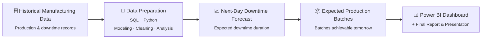

<div align="center">

# 🏭 Manufacturing Downtime Analysis & Forecasting

**Why does the plant stop, and when might it stop again?**

An end-to-end data analytics project that uncovers the root causes of production downtime,<br>
forecasts next-day downtime, and translates that forecast into the number of batches the plant can deliver.


</div>

---

## 📑 Table of Contents

1. [Project Overview](#-project-overview)
2. [Problem Statement](#-problem-statement)
3. [Objectives](#-objectives)
4. [Core Requirement](#-core-requirement)
5. [Project Workflow](#-project-workflow)
6. [Project Plan](#-project-plan)
7. [Batch Estimation Logic](#-batch-estimation-logic)
8. [Data Requirements](#-data-requirements)
9. [Tech Stack](#-tech-stack)
10. [Deliverables](#-deliverables)
11. [Repository Structure](#-repository-structure)
12. [Team](#-team)

---

## 🔍 Project Overview

Unplanned downtime is one of the most expensive problems on a production floor. Every minute a line stands still is lost output, idle labour, and a missed delivery commitment.

This project treats downtime as a **data problem**. Using historical manufacturing and stoppage records, it:

- **Explains the past:** identifies *why* the plant stops, which causes dominate, and where the losses concentrate.
- **Forecasts the near future:** predicts the expected downtime for the **next day of operation**.
- **Supports planning:** converts that forecast into the **expected number of production batches**, so management can plan the next shift with realistic targets.

The project goes beyond a dashboard of historical stoppages: its outcome is a forward-looking, decision-ready estimate of tomorrow's production capacity.

---

## ❓ Problem Statement

> ### *"Why does the plant stop, and when might it stop again?"*

Production managers typically see downtime only after it has happened. Without a structured view of downtime causes and a reliable short-term forecast, production plans are built on assumptions rather than evidence, which leads to missed targets and reactive decision-making.

This project answers two connected questions:

| # | Question | Approach |
|:-:|----------|----------|
| 1 | **Why** does the plant stop? | Descriptive and diagnostic analysis of historical downtime data |
| 2 | **When / how much** will it stop next? | Next-day downtime forecasting and batch output estimation |

---

## 🎯 Objectives

- Build a clean, well-structured **data model** for manufacturing and downtime data.
- Clean and prepare the data using **SQL** and **Python**.
- Define the **business questions** decision-makers need answered, and answer them with data.
- Develop a **forecasting model** for next-day downtime duration.
- Estimate the **number of batches** that can be produced the next day based on the forecast.
- Present all insights in an interactive **Power BI dashboard**, supported by a final report and presentation.

---

## ⭐ Core Requirement

> [!IMPORTANT]
> **Forecasting must include the prediction of downtime in the next day of operation. Then, accordingly, highlighting the number of batches to be produced.**

In practice this means the project's final output is not only *what happened*, but *what is expected to happen tomorrow* and *what that means for production volume*.

---

## 🔄 Project Workflow



| Stage | Description |
|-------|-------------|
| **1. Historical Manufacturing Data** | Past production and downtime records collected from the plant. |
| **2. Data Preparation** | Data modeling, cleaning, transformation, and exploratory analysis with SQL and Python. |
| **3. Next-Day Downtime Forecast** | A predictive model estimates downtime duration for the next operating day. |
| **4. Expected Production Batches** | The forecast is converted into the number of batches the plant can produce. |
| **5. Dashboard & Report** | Results are delivered through a Power BI dashboard, a written report, and a final presentation. |

---

## 🗓️ Project Plan

The project runs over **four weeks**, with each week building on the previous one.

### Week 1 — Data Modeling & Preprocessing
**Goal:** Prepare the data for analysis.

- Design and build the **data model**.
- Clean and prepare the data using **SQL** and **Python**.
- Explore the data with **pandas** and **Matplotlib**.

📦 **Deliverables:** Cleaned Dataset · Preprocessing Notebook

### Week 2 — Business Analysis
**Goal:** Define the questions decision-makers need answered.

- Define the **analysis questions** that explain the causes of production downtime.
- Identify which questions **can be answered** with the available data.
- Answer them using **SQL** and **Python**.

📦 **Deliverable:** A set of data-answerable analytical questions with findings

### Week 3 — Forecasting
**Goal:** Forecast downtime and estimate expected production.

- Forecast **downtime duration for the next operating day**.
- Use the forecast to **estimate the number of batches** that can be produced.
- Build with **Python**, **scikit-learn**, **pandas**, and **Matplotlib**.

📦 **Deliverable:** Visualization plots of the forecasting results

### Week 4 — Dashboard & Final Presentation
**Goal:** Present the results in a way that serves management.

- Build an interactive **Power BI dashboard**.
- Prepare the **final report** and **presentation**.
- Cover the analysis, model development, and deployment.

📦 **Deliverables:** Power BI Dashboard · Final Report · Presentation

### Summary

| Week | Phase | Tools | Deliverables |
|:----:|-------|-------|--------------|
| 1 | Data Modeling & Preprocessing | SQL, Python, pandas, Matplotlib | Cleaned Dataset, Preprocessing Notebook |
| 2 | Business Analysis | SQL, Python | Analytical Questions & Findings |
| 3 | Forecasting | Python, scikit-learn, pandas, Matplotlib | Forecast Visualization Plots |
| 4 | Dashboard & Presentation | SQL, Python, Power BI | Dashboard, Report, Presentation |

---

## 📦 Batch Estimation Logic

Once next-day downtime is forecast, the expected production output can be estimated with a simple capacity calculation:

```text
Expected Batches = (Available Operating Hours − Forecasted Downtime) ÷ Batch Cycle Time
```

| Input | Meaning |
|-------|---------|
| **Available Operating Hours** | Planned production time for the next operating day |
| **Forecasted Downtime** | Output of the forecasting model (Week 3) |
| **Batch Cycle Time** | Average time required to produce one batch |

> [!NOTE]
> **Assumption:** this formula is the working approach for estimating batches. Its exact form will be finalised once the dataset is available, and it depends on the plant data including the inputs listed above.

---

## 🗂️ Data Requirements

To deliver both the analysis and the forecast reliably, the dataset should ideally include:

| Category | Example Fields | Used For |
|----------|----------------|----------|
| **Downtime events** | Date, start/end time, duration, line/machine | Analysis & forecasting target |
| **Downtime causes** | Reason / category of the stoppage | Root-cause analysis |
| **Production records** | Batches produced, production date, line | Output analysis & validation |
| **Batch timing** | Batch cycle time per product or line | Batch estimation |
| **Operating schedule** | Planned / available operating hours per day | Batch estimation |

> [!NOTE]
> **Assumption:** batch cycle time and available operating hours are required to convert the downtime forecast into a batch estimate. Field names will be updated to match the actual dataset.

---

## 🛠️ Tech Stack

| Area | Tools |
|------|-------|
| **Data Preparation & Querying** | SQL |
| **Programming & Analysis** | Python, pandas |
| **Forecasting / Machine Learning** | scikit-learn |
| **Visualization** | Matplotlib |
| **Dashboard & Reporting** | Microsoft Power BI |

---

## ✅ Deliverables

- [ ] Cleaned Dataset
- [ ] Preprocessing Notebook
- [ ] Analytical Questions & Findings
- [ ] Next-Day Downtime Forecasting Model
- [ ] Forecast Visualization Plots
- [ ] Expected Batches Estimation
- [ ] Power BI Dashboard
- [ ] Final Report
- [ ] Final Presentation

---

## 📁 Repository Structure

```text
Manufacturing-Downtime-Analysis-Forecasting/
├── project/          # Project work: data, notebooks, SQL, models, dashboard, reports
├── README.md         # Project description (this file)
└── TEAM.md           # Team members
```

> The structure inside `project/` will grow as the work progresses.

---

## 👥 Team

The team members working on this project are listed in **[TEAM.md](TEAM.md)**.

---

<div align="center">

*Turning downtime data into tomorrow's production plan.*

</div>
